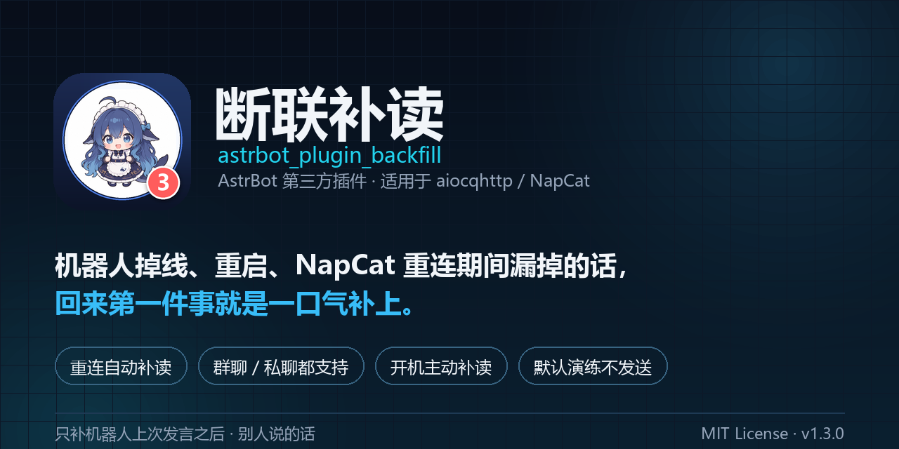
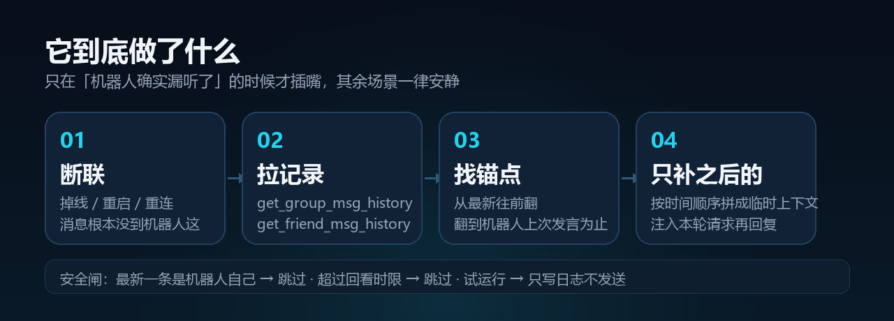

# 断联补读 · astrbot_plugin_backfill



> 机器人掉线、重启、NapCat 重连期间漏掉的话，回来第一件事就是一口气补上。

## 这是什么

**`astrbot_plugin_backfill` 是 [AstrBot](https://github.com/AstrBotDevs/AstrBot) 的第三方插件**（社区插件，不是 AstrBot 官方内置功能，也不能单独运行——必须挂在 AstrBot 进程里，由 AstrBot 扫描 `data/plugins/` 加载）。

它补的正是「QQ 智能体」这条链路上丢消息的那一段：

```
QQ 智能体  =  AstrBot（框架 / 大脑 / 插件宿主）  +  NapCat（QQ 客户端，走 OneBot v11）
                          │
                          └── data/plugins/astrbot_plugin_backfill/   ← 本插件
```

所以：插件负责「往回翻聊天记录」，AstrBot 负责「决定怎么回」，NapCat 负责「跟 QQ 说话」。三者缺一不可，本插件只做第一件事。

重连或重启之后，它会自动把**机器人没听到的那段对话**从聊天记录里翻出来、补进上下文，然后正常接着聊。

---

## 它解决什么问题

机器人的消息是「推」过来的——掉线、崩溃、重启、NapCat 掉 WS 的那段时间，用户说的话**根本没进 AstrBot**，也不会出现在对话历史里。等你把它重新拉起来，它一脸茫然：刚才发生的事它一点都不知道。

这个插件在重连/启动后做一件事：**回到聊天记录里把漏掉的那段翻出来**。

## 它做了什么



1. 按会话拉一段聊天记录（群用 `get_group_msg_history`，私聊用 `get_friend_msg_history`）
2. 从最新一条往前翻，**翻到机器人自己上一次发言为止**
3. 把它之后、**别人说的**话按时间顺序拼成一段临时上下文，注入本轮请求
4. 正常回复（开机补读时还会主动把这句话发出去）

### 只补这些，别的不管

- ✅ 机器人上次发言**之后**、**别人**说的话
- ❌ 机器人自己说过的话（不补，避免自我复读）
- ❌ 上下文里已经有的句子（文本比对去重）
- ❌ 已经补过的消息（按 `message_id` 落盘去重，重启不重复）
- ❌ 超出回看时间窗的老消息
- ❌ 最新一条就是机器人自己说的（说明已经回过，不插嘴）

读不到聊天记录、接口不支持、超时——一律**静默跳过**，不影响正常回复。

## 两种触发方式

| 触发 | 时机 | 行为 |
|---|---|---|
| 断联后第一条消息 | 距离上次处理超过 `gap_seconds`，或进程重启后的头一条 | 补读注入，然后正常回这条 |
| 开机主动补读 | AstrBot 启动后延迟 `startup_delay` 秒，自扫最近会话 | 补读后**主动发一句**回复（默认只演练不发送） |

开机补读的实际排程（`startup_delay` 只决定"第一下什么时候试"）：

`startup_auto_delay` 默认 **开**，也就是不用猜秒数：

```
自动模式（默认）：插件加载完 ──立即──▶ 每 3 秒探一次 get_login_info，探到就补读
固定模式（关掉）：插件加载完 ──等 startup_delay 秒──▶ 再按同样方式探
```

探活单轮上限 45 秒；没探到就等 30 秒再来，最多 3 轮——**最坏**约 `45+30+45+30+45 = 195 秒`（自动模式）/ `220 秒`（固定模式 25 秒起）才会放弃。
日志里会写 `启动补读：自动模式…`、`可用平台 N 个，从加载到就绪用时 X 秒` 或 `等不到 aiocqhttp 平台，本次放弃`。

## 安装

1. 把整个目录放到 `AstrBot/data/plugins/astrbot_plugin_backfill/`
2. 重启 AstrBot（新插件目录不会被热加载）
3. WebUI → 插件 → 断联补读，按需改配置

仓库：<https://github.com/XiaoDMeng/astrbot_plugin_backfill>（issues / PR 都收）

依赖：AstrBot `>= 4.13.0`，平台 `aiocqhttp`（NapCat 等 OneBot v11 实现）。

> **平台限制**：补读靠的是 OneBot v11 的 `get_group_msg_history` / `get_friend_msg_history`，所以**只对 QQ 系生效**（NapCat / Lagrange 等 aiocqhttp 实现）。
> Telegram、Discord、微信（`weixin_oc` / 公众号 / 企业微信）这些适配器**没有**"按会话拉历史"的接口——掉线期间的消息在服务端就取不回来，装上也不会工作，只会静默跳过。

## 配置

| 设置项 | 键 | 默认 | 说明 |
|---|---|---|---|
| 【基础】启用断联补读 | `enabled` | `true` | 总开关 |
| 【触发】间隔多久算断联 | `gap_seconds` | `600` | 同一会话距上次处理超过这个秒数就触发；进程重启后第一条必触发 |
| 【触发】最多回看多少小时 | `hook_hours` | `24` | 断联触发时只补这么多小时内的内容，`0` = 不限 |
| 【触发】新会话也补读 | `on_new_session` | `true` | 上下文为空的新会话也尝试补读 |
| 【读取】拉多少条聊天记录 | `history_count` | `50` | 向 OneBot 请求的历史条数 |
| 【读取】最多补多少条 | `max_messages` | `30` | 超出时保留最近的 |
| 【读取】注入文本上限 | `max_chars` | `3000` | 拼好的补读文本上限，超出按整行丢弃 |
| 【范围】群聊也补读 | `include_group` | `true` | 关掉后群里完全不处理 |
| 【范围】私聊也补读 | `include_private` | `true` | 关掉后私聊完全不处理 |
| 【格式】带上说明行 | `show_header` | `true` | 补读内容前加一句说明 |
| 【启动】开机自动补读 | `startup_catchup` | `true` | 关闭则只保留「断联后第一条消息」触发 |
| 【启动】自动决定何时开始 | `startup_auto_delay` | `true` | 开着就跳过固定等待：加载完立刻探平台，探到就补 |
| 【启动】启动后等几秒再扫 | `startup_delay` | `25` | 仅固定模式生效（自动模式关掉时才用） |
| 【启动】只看最近多少小时的会话 | `startup_hours` | `24` | 更早的会话不自扫 |
| 【启动】最多补几个会话 | `startup_max_sessions` | `3` | 防止开机一次冒出多条回复 |
| 【启动】只演练不发送 | `startup_dry_run` | `true` | 照常算、照常写日志，但不发送、也不标记已读 |

> 默认 `startup_dry_run = true`：先观察它「本来会说什么」，确认靠谱后再关掉这个开关，让它真的开口。

## 自测命令

管理员在任意会话里发：

```
/补读自测
```

（别名 `backfill_test`）会把这一次的诊断直接回给你：拉了 N 条、机器人上次发言在第几条、去重掉了什么、最终补到什么内容。自测**不写去重、不改历史**。

## 日志速查

```
[backfill] 生效配置：dry_run=True 群聊=True 私聊=True hook_hours=24 startup_hours=24
[backfill] 触发 <会话> first=True gap=3600s new=False
[backfill] 已补读 <会话>：288 字
[backfill] 未补 <会话>：get_friend_msg_history 拉到 50 条 | 最新一条就是机器人自己说的，已经回复过，不补
[backfill] 试运行：本该回复 <会话>：在想你刚才说的事呢
```

## 注意

- **只在 `aiocqhttp` 平台有效**：依赖 OneBot 的 `get_*_msg_history` 接口；微信/Telegram 等适配器会直接跳过
- 群里补读**不区分「是不是在跟它说话」**：那段时间别人说的话会整段进上下文，模型有可能对着无关话题接一句
- 去重记录写在插件目录的 `seen.json`，删掉即清空；重装插件会丢（后果只是可能重复补一次）

## 更新记录

- **v1.3.1** 补上 `metadata.yaml` 的 `repo` 字段，AstrBot 插件详情里能看到仓库地址
- **v1.3.0** 新增 `startup_auto_delay`（默认开）：不再靠猜秒数，平台一应答就补读；启动日志带「从加载到就绪用时」
- **v1.2.4** 新增群聊/私聊独立开关；`startup_dry_run` 默认改为开启；启动时打印生效配置
- **v1.2.3** 新增 `hook_hours`，两处补读时间窗统一
- **v1.2.2** 主动回复后把「最后一句用户消息 + 回复」写进会话历史
- **v1.2.1** 修复配置项类型错误导致任务静默死亡；`send_message` 校验返回值；平台就绪探测改为 `get_login_info` 探活并重试
- **v1.2.0** 新增开机主动补读、回看时间窗、最新一条守卫、`seen.json` 落盘加锁
- **v1.1.0** 去重集合落盘
- **v1.0.0** 初版

## 许可

[MIT](LICENSE)
